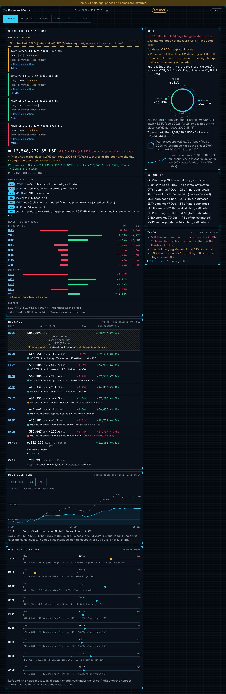
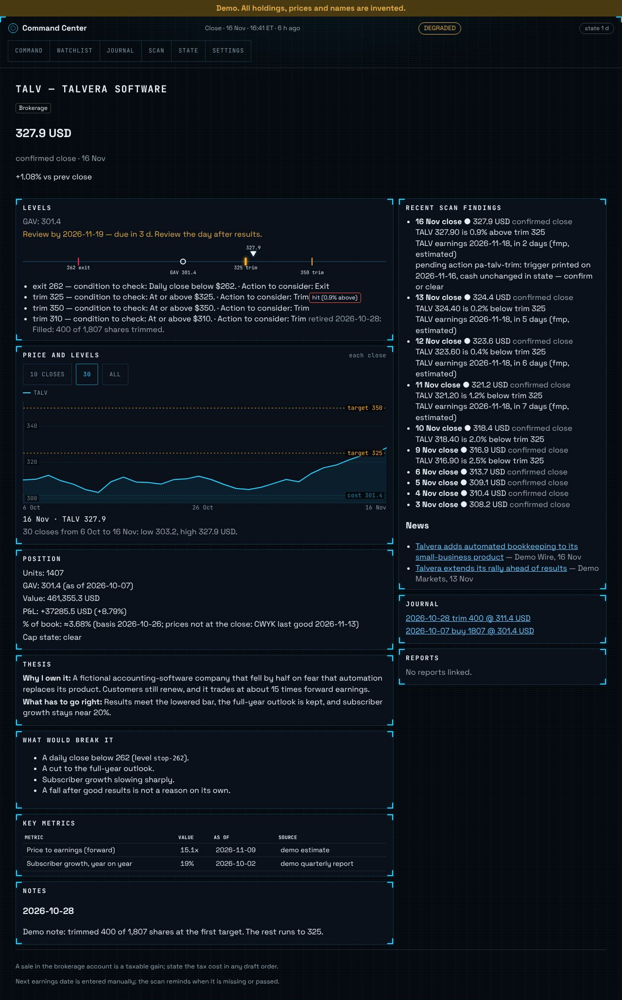

# Command Center

A private investment command center: one screen that shows a portfolio's positions, the written reason for each,
the price levels that would make me act, and what changed since the last market close.

**This repository is the public demo.** Every holding, price, company and fund in it is invented. The real one runs
on my own portfolio and stays private.

**[Open the live demo](https://oskar-norborg.github.io/command-center-demo/)**

## What it does

- **Checks every position against written levels.** Each holding has a stop, targets and a review date. A scheduled
  scan after each close compares prices with those levels and reports what was hit, what is near, and what is overdue.
- **Keeps the reasoning next to the position.** Each position page has three lines: why I own it, what has to go
  right, and what would make me sell. Every trade is journaled with the reasoning at the time and graded later, once
  for the decision and once for the outcome.
- **Says how sure each number is.** A price is labelled a confirmed close, an intraday print, a last close not yet
  confirmed, or a failed fetch. Anything derived from a price that is not a confirmed close is marked ≈.
- **Never tells me to trade.** An alert names a level and the condition to check. It does not say buy or sell.

## What the demo shows

- A book of about 12.5 million USD: nine companies, four funds and cash.
- A target that was reached, a stop within 3%, a watchlist name at its buy level, earnings within a week, one review
  overdue, and one price that failed to load, so every panel has something in it.
- Charts drawn from three months of invented closes: the book over time, the distance from each price to its
  levels, and each position's price against its levels.

The demo dates itself: it always shows the latest market close, without being rebuilt.

## How it is built

- **Three parts.** State is a set of small YAML and Markdown files. A scan is a scheduled script that fetches prices
  and writes one JSON file per close. The site is a static build that reads both and only displays.
- **Every change to the state goes through a pull request** with automated checks, including one that refuses to
  let the record of a name I sold or turned down disappear.
- **No framework and no server.** Plain JavaScript modules, hand-written SVG charts, about 1,100 automated tests.
- **A leak check guards this demo.** The build searches its own output for any real ticker, name, figure or line of
  text from the private book and refuses to publish if it finds one.

I wrote the specification and reviewed every change. The code was written with AI coding agents working from that
specification, one small task at a time.

## About this repository

It holds the built demo site only, published automatically from the private repository. The source lives there.
